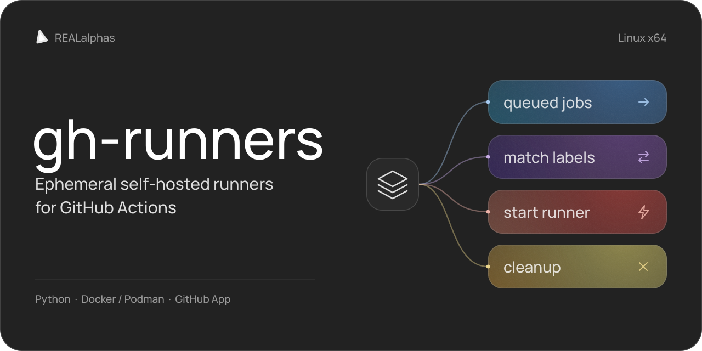

# GitHub Runners Controller

A small controller that starts one-job GitHub Actions runners. It finds queued jobs through a GitHub App, selects a free slot with matching labels, and starts a fresh container for each runner.

## 1. Create a GitHub App

In GitHub, open **Settings → Developer settings → GitHub Apps → New GitHub App**. Disable webhooks and choose **Only on this account**. Set the following **Repository permissions**.

| Permission | Access |
| --- | --- |
| Actions | Read-only |
| Administration | Read and write |
| Contents | Read-only |
| Metadata | Read-only |

Install the App on your account or organization. Use **All repositories** if the controller should also discover repositories you create later. To limit its access, select the repositories that use these runners.

Contents access lets the controller inspect private workflow files. If the installation cannot read them, it checks the queue of each private repository with active workflows.

Copy the **App ID** from the App's settings. Find the **installation ID** at the end of the URL on the installation's **Configure** page. Generate a private key and store the PEM file outside the checkout with mode `0600`. The account running the controller must be able to read it.

## 2. Get a worker image

Use a Linux x86-64 host with Docker, Python 3.11 or newer, and OpenSSL. Run commands from the checkout.

Build locally with Docker.

~~~sh
docker build -t gh-runners:local .
~~~

You can also pull a published image. Set `OWNER` to the lowercase repository owner.

~~~sh
OWNER=your-github-owner
docker pull "ghcr.io/$OWNER/gh-runners:latest"
~~~

For a private package, authenticate with a token that has `read:packages` and access to that package. Set `GHCR_USER` and `GHCR_TOKEN` in your secret store or shell environment before running one of these commands.

~~~sh
printf '%s\n' "$GHCR_TOKEN" | docker login ghcr.io --username "$GHCR_USER" --password-stdin
~~~

The GitHub Actions publish workflow builds the same image for GitHub Container Registry. Pin a published image by digest for repeatable deployments.

## 3. Start the controller

~~~sh
cp config.example.json config.json
chmod 600 config.json
python3 -m venv .venv
.venv/bin/pip install -r requirements.txt
.venv/bin/python controller.py config.json
~~~

Before starting, edit `config.json`.

- Set `app_id`, `installation_id`, and `key_path` from step 1.
- Set `engine` to `docker`.
- Set `image` to the local tag or the published image reference from step 2.
- Give each slot a unique name. Set its label, CPU quota, and memory limit. Keep distinct instance names when running separate controllers against the same container engine.
- Optionally set `cache_root` to an absolute path on the container host and create a directory under it for each slot. The controller persists npm package content per repository. Slots with `cargo_build_jobs` also reuse Cargo registry archives. Set a filesystem quota of 10 GiB on each slot directory to bound disk use.
- `cargo_build_jobs` sets the worker default. Environment variables in individual workflows take precedence. Enable `cache_private_cargo_targets` to reuse compiled output for private repositories with fork workflows disabled. Use `cargo_target_cache_repositories` only for repositories where all jobs can trust each other's build artifacts.
- Set `nix_config` on a slot for Nix build settings such as `cores`. The controller appends any `repository_nix_config` settings and passes both through `NIX_CONFIG`.
- Set `nix_binary_cache` to the absolute host path of a local Nix binary cache populated with signed artifacts. Workers access it through a read-only mount.
- When slots are free, the controller checks default-branch workflow files every 10 minutes to identify repositories using this pool. It checks those repositories for active runs every minute and checks jobs in active runs every 10 seconds. The intervals are configurable.

Include the runner labels in a default-branch workflow to discover a repository whose first self-hosted jobs are on a feature branch. Workflows with computed labels or external reusable workflows also stay eligible for queue checks.

The process needs permission to invoke the container engine. For unattended operation, use a service manager to restart the controller after a reboot. With systemd, set `KillMode=process` so restarting the controller leaves active container clients running. Use GitHub Actions to cancel an active job.

## 4. Try a workflow

Save this workflow in `.github/workflows/runner-smoke.yml` in a repository covered by the App installation. Open the **Actions** tab and select **Run workflow**.

~~~yaml
name: Runner smoke test
on: workflow_dispatch
jobs:
  smoke:
    runs-on: [self-hosted, small]
    steps:
      - run: echo "Runner is ready"
~~~

Use `runs-on: [self-hosted, large-compute]` for a slot with the `large-compute` label. If a job stays queued, verify the App installation includes the repository and the labels in the workflow match a free slot in `config.json`.

Use a dedicated execution host for jobs you trust. Keep the App private key and container-engine socket on the controller side. Review workflows before allowing pull-request jobs to run on self-hosted infrastructure.
